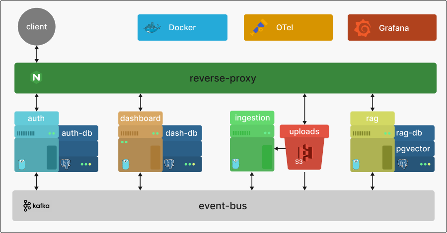

# Raggy - A RAG Pipeline

Raggy is a prototype RAG (Retrieval-Augmented Generation) pipeline built to explore distributed system design. It uses separate services for document processing, embedding generation, and retrieval-based responses.

The backend query API returns answers with validated source references or an explicit insufficient-evidence result.

For local pipeline development without a Gemini key or external AI calls, set `AI_PROVIDER=fake` on the RAG service.

Document processing uses bounded, named retry policies and reports terminal failures with partial progress in the dashboard.

 

_A high-level overview of the services that make up the pipeline._

 

**Distributed Tracing:** Uses OpenTelemetry to trace requests and document processing across services, with traces stored in Grafana Tempo.

**Centralized Logging:** Collects Docker container logs with Grafana Alloy and stores them in Loki, with Grafana providing an interface for exploring logs and traces.

 

**Session Management:** Generates and manages Access and Refresh tokens to handle authentication and user sessions.

**Stateless:** Implements asymmetric public/private key token verification so downstream services can verify identity without querying a central database or the authentication service.

 

**Process Orchestration:** Provides the primary interface allowing document uploads to be created and scheduled for pipeline processing.

**Real-time Feedback:** Tracks and surfaces metrics regarding processing states and ingestion status directly to the client.

 

**Data Extraction:** Pulls raw files staged in AWS S3 storage as soon as an ingestion job triggers.

**Parsing & Chunking:** Processes the contents, breaking the raw input into chunks tailored for downstream vector embedding.

 

**Embedding Generation:** Converts text chunks into vector representations, handling the embeddings process either locally or via external APIs like Gemini.

**Contextual Querying:** Orchestrates the core RAG logic by retrieving relevant document chunks based on a user's prompt and feeding that grounded context into the LLM API to generate accurate answers.

 

## Attributions

The icons used in the SVG service headers are from [Noun Project](https://thenounproject.com/) and licensed under [CC BY 3.0](https://creativecommons.org/licenses/by/3.0/):

- [Binoculars](https://thenounproject.com/browse/icons/term/binoculars/) by Symbolon — Observability.
- [Lock](https://thenounproject.com/browse/icons/term/lock/) by Danil Polshin — Auth Service.
- [dashboard](https://thenounproject.com/browse/icons/term/dashboard/) by iconisme — Dashboard Service.
- [CPU](https://thenounproject.com/browse/icons/term/cpu/) by Kasanah — Ingestion Worker.
- [AI](https://thenounproject.com/browse/icons/term/ai/) by Moala Imkong Imsong — RAG Service.
